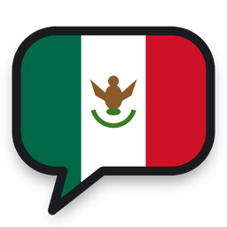

<p align="center"></p>

# Órale

**Órale** est une application pour apprendre l'espagnol du Mexique quand on est francophone, dans l'esprit de Drops. Une session dure 5 minutes et se joue entièrement au toucher.

C'est une **web app installable (PWA)**. Elle s'installe sur l'iPhone depuis Safari, sans App Store et sans licence développeur, puis fonctionne en plein écran et hors-ligne.

## 📲 Installer l'app sur ton iPhone

### 1. Mettre l'app en ligne (une seule fois, gratuit)

1. Le dépôt GitHub doit être **public**. Avec un compte gratuit, GitHub Pages ne fonctionne pas sur les dépôts privés.
2. Sur GitHub, ouvre **Settings → Pages**.
3. Dans *Build and deployment*, choisis **Source : Deploy from a branch**.
4. Sélectionne la branche qui contient l'app (par exemple `main` après fusion), dossier **`/ (root)`**, puis **Save**.
5. Après une à deux minutes, l'app est disponible à l'adresse `https://<ton-pseudo>.github.io/<nom-du-dépôt>/`.

### 2. L'ajouter à l'écran d'accueil

1. Sur l'iPhone, ouvre cette adresse dans **Safari**.
2. Touche le bouton **Partager** (le carré avec une flèche).
3. Choisis **« Sur l'écran d'accueil »**, puis **Ajouter**.

L'icône Órale apparaît sur ton écran d'accueil. L'app s'ouvre en plein écran, fonctionne sans réseau et ne périme jamais. Elle se met à jour automatiquement à chaque modification poussée sur GitHub.

> 🔊 **Le son** : chaque mot, phrase et réplique de dialogue est accompagné d'un fichier audio enregistré. Les sons de l'app fonctionnent même en mode silencieux à partir d'iOS 17. Sur une version plus ancienne, désactive le mode silencieux.
> Dans **Profil › Voix**, tu peux aussi choisir la voix de l'iPhone. Pour un vrai accent mexicain, installe d'abord la voix : Réglages iPhone › Accessibilité › Contenu énoncé › Voix › Espagnol (Mexique), puis la version « améliorée » de Paulina ou de Juan.

> 💾 Ta progression est enregistrée sur le téléphone. L'onglet **Profil** permet de l'exporter ou de l'importer, pour la sauvegarder ou changer d'appareil.

## ✨ Fonctionnalités

- **Test de niveau adaptatif** (A1 → B2) : 4 questions par niveau, on monte tant qu'on en réussit au moins 3.
- **32 thèmes de la vie au Mexique**, 8 par niveau : taquería, marché, Día de Muertos, lucha libre, la chamba, l'argot chilango, l'histoire du Mexique… Le contenu compte **448 éléments** :
  - des mots illustrés ;
  - des phrases ;
  - un point de grammaire par thème ;
  - un dialogue par thème.
- **Des voix partout** :
  - environ 620 enregistrements générés avec le modèle neuronal Supertonic 3, en espagnol ;
  - dans les dialogues, une voix féminine ou masculine selon le personnage ;
  - repli possible sur la voix mexicaine de l'iPhone (es-MX).
- **Illustrations dessinées** : plus de 270 dessins vectoriels faits main, dans un style BD assorti au logo. Chaque mot a son illustration.
- **Répétition espacée** : un élément revient après 1, 3, 7, 14, 30, 60, 120 puis 240 jours. Une erreur le fait redescendre d'une étape et il revient dès le lendemain.
- **Apprentissage d'un nouvel élément** : il est d'abord présenté (image, mot, traduction, audio), puis doit être retrouvé **3 fois** dans la session avant d'être compté comme appris.
- **Difficulté progressive** : reconnaître l'image → choisir le mot → épeler → écrire ou comprendre à l'oral. La légende française sous les images disparaît à mesure qu'on progresse.
- **Leçons mélangées** : chaque leçon combine les nouveautés du thème et des révisions d'autres thèmes.
- **Côté ludique** :
  - sessions chronométrées de 5 minutes ;
  - sons de validation ;
  - combos ;
  - série de jours ;
  - objectif quotidien (5, 10, 15 ou 20 min) ;
  - XP ;
  - passage automatique au niveau suivant quand 80 % du niveau est appris.
- **Onglet Révisions** : ce qui est à revoir aujourd'hui et une prévision sur 7 jours.
- **Onglet Découvrir** : films, séries, livres et podcasts mexicains adaptés à chaque niveau.

## 🛠️ Développement

Le code est en HTML, CSS et JavaScript, sans dépendance ni étape de compilation.

```bash
# Lancer en local (puis ouvrir http://localhost:8080)
python3 -m http.server 8080

# Régénérer le contenu après modification de tools/build_content.py
python3 tools/build_content.py

# Régénérer les illustrations (tools/art/*.py → js/data/art.js)
python3 tools/build_art.py --preview apercu.html

# Régénérer les voix (nécessite sherpa-onnx, num2words, ffmpeg et le modèle Supertonic 3)
python3 tools/build_audio.py --model chemin/vers/supertonic-3 --only-missing

# Régénérer les icônes (nécessite Pillow)
python3 tools/build_icons.py
```

Après une modification du contenu, relance `build_content.py`, puis `build_audio.py --only-missing` pour enregistrer les nouvelles phrases.

Organisation du code :

| Fichier | Rôle |
| --- | --- |
| `tools/build_content.py` | Source du contenu (thèmes, mots, phrases, grammaire, dialogues, recommandations) → `js/data/content.js` |
| `js/srs.js` | Répétition espacée |
| `js/store.js` | Progression, série, objectif, prévisions (stockage local) |
| `js/exercises.js` | Création des exercices selon la maîtrise |
| `js/lesson.js` | Moteur d'une session de 5 minutes |
| `js/placement.js` | Test de niveau adaptatif |
| `js/speech.js` / `js/sound.js` | Voix mexicaine et effets sonores |
| `tools/art/` | Illustrations SVG dessinées en code (un fichier par niveau) |
| `tools/build_audio.py` / `audio/` | Voix enregistrées (une empreinte par texte) |
| `js/ui/` | Écrans de l'app |
| `sw.js` | Fonctionnement hors-ligne |

Après l'ajout d'un nouveau fichier JS, ajoute-le à la liste `ASSETS` de `sw.js` et incrémente `CACHE` pour qu'il soit disponible hors-ligne.
